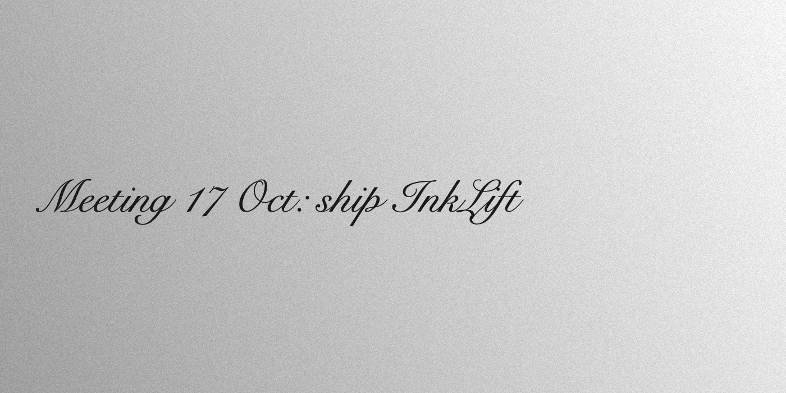
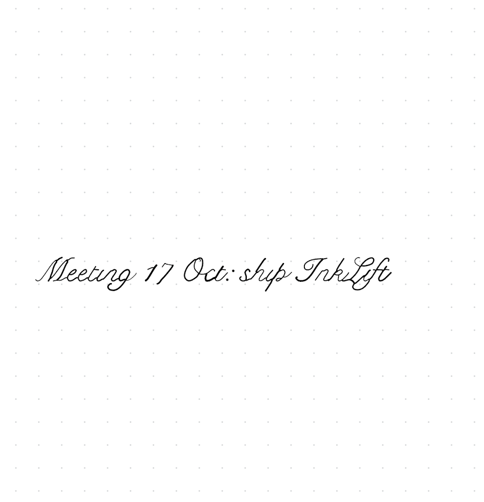

# InkLift

Photograph a page of handwritten notes. Get a Goodnotes document with the handwriting as
real ink strokes, not a flat picture.

| Photo | In Goodnotes |
|---|---|
|  |  |

```
photo -> find page (Vision) -> flatten -> binarize (Sauvola) -> thin (Zhang-Suen)
      -> trace centerlines -> smooth -> strokes -> .goodnotes  (or PDF)
```

Everything runs on-device with Apple frameworks only. No network, no accounts.

## Mac app

Needs macOS 14 or newer and the Xcode Command Line Tools (`xcode-select --install`).
Full Xcode is not required.

```sh
git clone https://github.com/yellowHatpro/InkLift.git
cd InkLift
./scripts/make-mac-app.sh          # builds ~/Applications/InkLift.app
open ~/Applications/InkLift.app
```

Drop a photo in (or ⌘O), check the traced ink on the right, click **Export GoodNotes...**,
then **Open in Goodnotes**. Goodnotes syncs the document to your iPad through iCloud.

## Command line

```sh
swift build -c release
.build/release/inklift photo.jpg -o notes.goodnotes
.build/release/inklift photo.jpg -o notes.pdf
.build/release/inklift photo.jpg -o x.pdf --debug-dir dbg   # intermediate PNGs
```

Options: `--no-rectify` (skip page detection), `--page a4|letter` (PDF page size).

## iPad app

`App/` holds a SwiftUI iPadOS app (camera or photo picker, PencilKit preview, share
sheet). Building it needs Xcode on a Mac:

```sh
brew install xcodegen
cd App && xcodegen generate && open InkLift.xcodeproj
```

## Repository layout

| Path | What |
|---|---|
| `Sources/InkCore` | pipeline (`Pipeline/`), data model (`Model/`), exporters (`Export/`) |
| `Sources/inklift` | macOS CLI |
| `Sources/InkLiftMac` | macOS app |
| `App/` | iPadOS app (xcodegen spec) |
| `Tests/InkCoreTests` | Swift Testing suite on synthetic fixtures (`./scripts/test.sh`) |
| `docs/goodnotes-format.md` | the `.goodnotes` fields the writer emits and how they were found |
| `scripts/gn_*.py` | dump tools for `.goodnotes` files (use with parser-for-goodnotes) |

## The .goodnotes writer

A `.goodnotes` file is a ZIP of protobuf streams. Strokes are TPL images inside Apple
framed LZ4 blobs. InkLift ships a one-page template (indexes, events, a dot-grid
background PDF it generates itself) and writes the stroke stream. Details and field
tables: [docs/goodnotes-format.md](docs/goodnotes-format.md).

Tested with Goodnotes 7.1.18 for Mac. The format is undocumented; a Goodnotes update can
break it.

## Credits

Read-side format knowledge comes from
[Kaih1825/parser-for-goodnotes](https://github.com/Kaih1825/parser-for-goodnotes) (MIT);
the template's index and event records were derived from its sample document.
Not affiliated with Goodnotes Limited.

## License

MIT, see [LICENSE](LICENSE).
